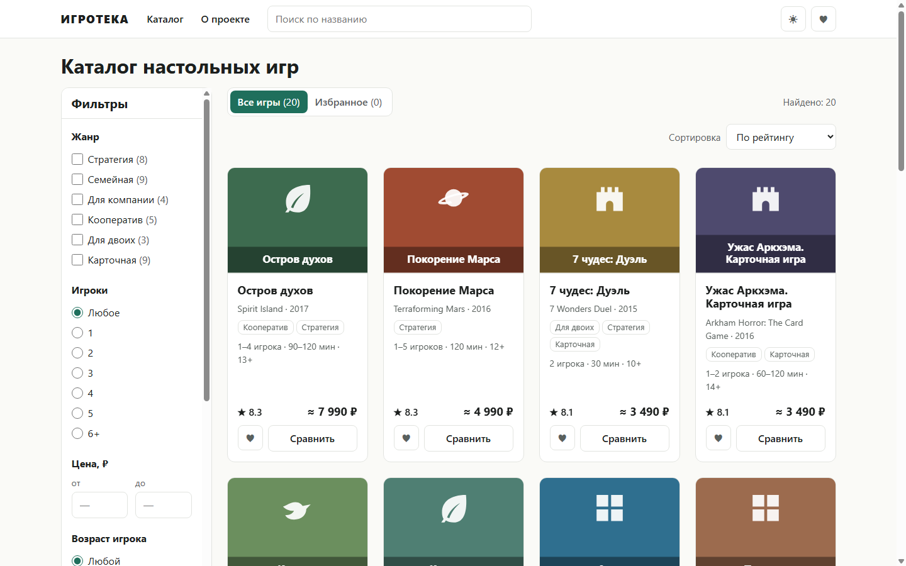
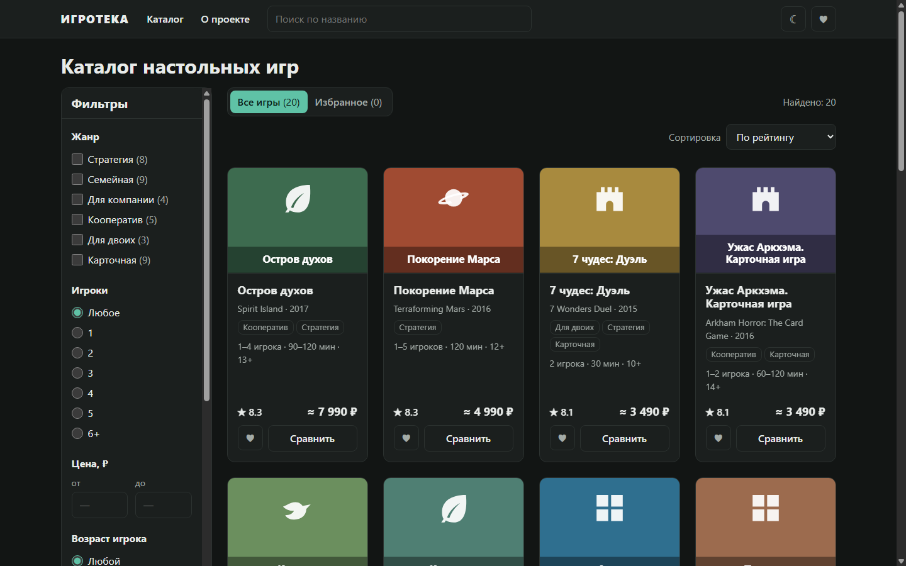
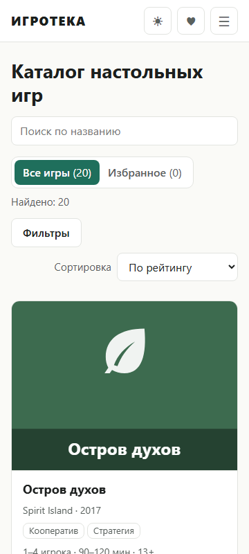
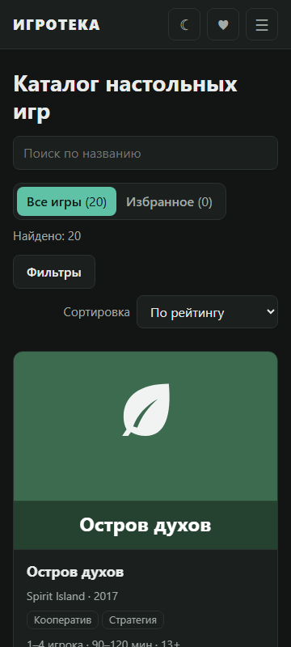

# ИГРОТЕКА

Интерактивный каталог реальных настольных игр: поиск, фильтры, избранное, сравнение, светлая и
тёмная тема. Статический сайт без единой зависимости, публикуется на GitHub Pages только после
прохождения тестов.

**Живой сайт:** https://axozu.github.io/igroteka/

| Светлая тема | Тёмная тема |
|---|---|
|  |  |

| Телефон, светлая | Телефон, тёмная |
|---|---|
|  |  |

## Возможности

- **20 реальных игр** — факты сверены с BoardGameGeek и сайтами российских издателей.
- **Поиск** по русскому и оригинальному названию (без учёта регистра и «ё»).
- **Фильтры:** жанр, число игроков, цена, возраст, время партии, сложность; чипы активных
  фильтров; на телефоне — полноэкранный лист.
- **Сортировка:** по рейтингу, цене, названию, году.
- **Избранное** с панелью и суммой; сохраняется в браузере и синхронизируется между вкладками.
- **Подробная карточка** игры и **сравнение** до трёх игр с выделением лучших значений.
- **Состояние в адресе:** фильтры, поиск, сортировка и открытая игра — в ссылке, работает «Назад».
- **Темы:** как в системе / светлая / тёмная, без «вспышки» при загрузке.
- **Плавные анимации** появления карточек, окон и разделов; полностью отключаются, если в системе
  включено «уменьшение движения».
- **Доступность:** семантическая разметка, работа только с клавиатуры, видимый фокус,
  `aria-live`, удержание фокуса в окнах, контраст текста ≥ 4.5:1 в обеих темах.
- **Адаптивность:** 360 / 768 / 1024 / 1440 px, масштаб 200 %, ландшафт телефона.

## Безопасность

Строгая Content Security Policy с Trusted Types, безопасное построение DOM без `innerHTML`,
проверка всех входных данных (адрес, localStorage, `games.json`), ноль зависимостей, публикация
через GitHub Actions с закреплёнными по SHA actions. Подробно — в [SECURITY.md](SECURITY.md).

## Архитектура

Чистые ES-модули без сборки и фреймворков, однонаправленный поток данных:

```
адрес / localStorage / games.json
        │  (проверка по белым спискам)
        ▼
   store (createStore) ──► подписчики ui/* ──► DOM через h()/svg()
        ▲                                         │
        └──────────── setState ◄── события (делегирование)
```

- `public/js/logic/` — **чистые функции** (поиск, фильтры, сортировка, URL, хранение,
  сравнение, проверка данных). Без `document`, `window`, `localStorage` — всё браузерное
  передаётся аргументами, поэтому логика целиком покрыта тестами `node:test`.
- `public/js/ui/` — отрисовка и обработчики; `public/js/*.js` — store, загрузка, синхронизация
  с адресом, сервисы избранного и сравнения.
- Данные — только в `public/data/games.json`, отдельно от кода.

## Запуск

Нужен Node.js ≥ 22. Устанавливать пакеты не нужно.

```sh
npm start   # http://127.0.0.1:8080/ и http://127.0.0.1:8080/igroteka/ (как на GitHub Pages)
npm test    # все тесты (node --test)
```

## Структура

```
public/              всё, что публикуется (и только это)
  index.html, 404.html, favicon.svg
  css/               tokens.css (переменные, темы) · base.css · components.css
  data/games.json    каталог
  js/                main.js, store.js, api.js, url-sync.js, сервисы, theme-init.js
    logic/           чистые функции
    ui/              компоненты интерфейса
tests/               logic/ · data/ · ui/ · security/ (сканеры кода, CSP, секреты, workflow)
scripts/serve.mjs    локальный сервер (не публикуется)
.github/workflows/   тесты → публикация на GitHub Pages
docs/                спецификация, план, чеклист интерфейса, скриншоты
```

## Lighthouse

Результаты на опубликованном сайте — в [docs/checklists/ui.md](docs/checklists/ui.md)
(заполняются после публикации).

---

Цены ориентировочные, данные приведены для демонстрации. Названия игр принадлежат их
правообладателям; обложки на сайте — сгенерированные иллюстрации, а не оригинальные изображения.
